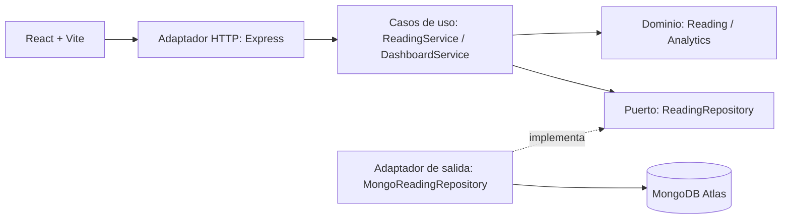

# Documentación técnica: Arquitectura Hexagonal y SOLID

## Problema que resuelve

Muchos hogares desconocen qué aparatos consumen más energía y qué costo generan. EnergyWise permite registrar lecturas en kWh, valorar sus costos en pesos colombianos, identificar tendencias y administrar una meta mensual.

## Arquitectura Hexagonal

**Dominio:** `Reading.ts` valida las lecturas y calcula su costo. `Analytics.ts` agrega consumo mensual, distribución por categorías, porcentaje de meta y recomendaciones. Son funciones puras sin dependencia de frameworks.

**Aplicación:** `ReadingService.ts` coordina el CRUD y la carga de ejemplos; `DashboardService.ts` produce los indicadores. Solo conocen la interfaz `ReadingRepository`.

**Puerto de salida:** `application/ports/ReadingRepository.ts` define el contrato que debe cumplir cualquier mecanismo de persistencia.

**Adaptador de salida:** `MongoReadingRepository.ts` implementa dicho puerto usando MongoDB y Mongoose. Cambiar MongoDB por PostgreSQL solo exigiría crear otro adaptador.

**Adaptador de entrada:** `presentation/routes.ts` transforma HTTP en invocaciones a los casos de uso; `presentation/app.ts` gestiona middleware y errores, y `server.ts` configura las dependencias.

## SOLID aplicado

1. **S — Single Responsibility:** dominio, casos de uso, capa HTTP y repositorio tienen responsabilidades concretas y separadas.
2. **O — Open/Closed:** se puede añadir una implementación SQL del puerto `ReadingRepository` sin cambiar los casos de uso.
3. **L — Liskov Substitution:** cualquier repositorio que cumpla el contrato puede sustituir a `MongoReadingRepository`.
4. **I — Interface Segregation:** la interfaz expone solo las operaciones de lectura/escritura que necesita la aplicación; no contiene operaciones específicas de MongoDB.
5. **D — Dependency Inversion:** `ReadingService` y `DashboardService` dependen de `ReadingRepository`, no de Mongoose; `server.ts` inyecta la implementación concreta.

## Clean Code y refactorización

- **Nombres expresivos:** `analyzeConsumption`, `assertReadingInput`, `calculateCost`, `seedExamples`, `MongoReadingRepository`.
- **Funciones pequeñas y cohesivas:** validación, cálculos, consulta y persistencia se ejecutan por separado.
- **Evitar duplicación (DRY):** validación de lectura reutilizada en crear/editar; formateo de moneda centralizado en React.
- **Reglas aisladas:** cálculos puros son comprobables mediante pruebas unitarias sin conectar MongoDB.
- **Refactorización estructural aplicada en el diseño:** extracción de las reglas de negocio desde las rutas HTTP hacia `domain` y `application`; extracción de consultas Mongoose hacia un adaptador de persistencia. Esto describe una separación final propuesta, no un historial verificable de cambios.

## Relaciones y flujo de datos

1. Usuario ingresa lectura con período, categoría, kWh, tarifa y nota en React.
2. React manda `POST /api/readings` a Express.
3. `ReadingService.create()` llama a `assertReadingInput()` para validar reglas de negocio.
4. El servicio invoca `ReadingRepository.create()`.
5. `MongoReadingRepository` guarda la entidad en MongoDB Atlas y devuelve el resultado.
6. React actualiza el historial y los indicadores obtenidos desde `/api/dashboard`.

## Decisiones de despliegue

- **Un solo servicio Render:** Docker construye el frontend y backend por separado; Express sirve los archivos estáticos de React y la API REST.
- **MongoDB Atlas externo:** registros persistentes sin depender del almacenamiento efímero del contenedor Render.
- **Variables de entorno:** `MONGODB_URI` nunca se incrusta en el frontend ni en el código versionado.
- **Observabilidad básica:** `/api/health` responde al control de salud de Render.
- **Riesgo conocido:** sin autenticación, el CRUD es público; es una demo académica con datos ficticios.

## Posibles extensiones

Autenticación JWT y roles; separación de datos por usuario; alertas por consumo atípico; reportes PDF; integración con medidores inteligentes; exportación CSV; pruebas de integración con MongoDB de prueba; auditoría y seguimiento de cambios.
